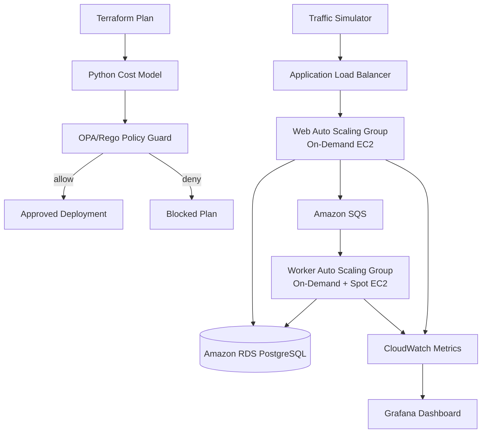

# FinOps CloudScale

**A cost-aware, autoscaling AWS platform that protects critical traffic while using Spot capacity for non-critical workloads.**

FinOps CloudScale combines infrastructure automation, policy-based cost controls, workload-aware scaling, observability, and failure testing in one project. It is designed to demonstrate how a cloud platform can balance **cost, reliability, and performance** instead of simply keeping a fixed fleet running all the time.

> **Status:** This repository contains infrastructure-as-code, application code, local development tooling, test scripts, and a GitHub Actions pipeline. AWS deployment requires your own configured AWS account and can incur charges. Start with the local workflow below.

## What problem does it solve?

A fixed server fleet can waste money when traffic is low and struggle when traffic spikes. Moving every workload to Spot Instances is cheaper, but interruptions can affect important requests.

This project uses two workload tiers:

- **Web tier (On-Demand):** handles critical requests and protects them from Spot interruptions.
- **Worker tier (mixed On-Demand + Spot):** processes queued, non-critical work where interruption risk is more acceptable.

An Application Load Balancer routes traffic, SQS buffers background jobs, and scaling policies respond to demand. Before a Terraform plan can be applied, a cost model and Open Policy Agent (OPA) policy check the projected compute cost and required tags.

## Highlights

- **Infrastructure as Code:** Terraform modules for networking, load balancing, compute, scaling, database, queue, IAM, storage, observability, and chaos testing.
- **Cost guardrails:** projected-cost model plus OPA/Rego policies to block plans that exceed the configured budget cap or violate rules.
- **Demand-based scaling:** EC2 Auto Scaling Groups for the web and worker tiers.
- **Critical-traffic protection:** request priority is derived from the service-priority dataset; critical traffic is routed away from Spot capacity, and the application has a Spot safety check.
- **Queue-backed background work:** Amazon SQS decouples non-critical jobs from web requests.
- **Monitoring:** CloudWatch metrics and a Grafana dashboard for capacity, traffic, queue length, latency, errors, and cost indicators.
- **Automated delivery:** GitHub Actions validates the code, runs tests and a local traffic simulation, plans infrastructure, checks policy, and supports deployment.
- **Resilience testing:** scripts for Spot interruption, latency injection, scale-in behaviour, and evidence collection.
- **Cost measurement:** scripts produce a report comparing baseline and measured optimized compute cost.

## Architecture



**Request flow:** the simulator sends requests to the ALB. Critical requests are directed to the On-Demand web tier. Web instances can enqueue non-critical jobs for workers. Metrics and cost indicators feed the observability stack.

**Deployment flow:** Terraform creates a plan, the Python cost model estimates projected compute spend, and OPA evaluates budget and compliance policies. The pipeline should only apply a plan that passes its guardrails.

## Technology stack

| Area | Tools |
|---|---|
| Cloud | AWS EC2, Auto Scaling, ALB, VPC, RDS PostgreSQL, SQS, Lambda, CloudWatch, S3, IAM, SSM, Secrets Manager |
| Infrastructure as Code | Terraform |
| Policy as Code | Open Policy Agent (OPA), Rego |
| Application | Python, FastAPI, PostgreSQL |
| Containers | Docker, Docker Compose, Amazon ECR |
| Observability | CloudWatch, Grafana |
| CI/CD | GitHub Actions with AWS OIDC |
| Testing | pytest, traffic simulator, shell-based integration and chaos tests |

## Repository map

| Path | Purpose |
|---|---|
| `app/` | FastAPI service, application logic, Dockerfile, and API tests |
| `terraform/` | Bootstrap configuration, reusable modules, and dev/baseline environments |
| `policies/` | OPA/Rego budget and tagging policies with tests |
| `finops/` | Cost estimation, measured cost reports, input validation, and window summaries |
| `finops-app/simulator/` | Traffic simulator that replays CSV traffic profiles |
| `finops-app/data/` and `data/` | Traffic profiles, pricing inputs, budget setting, and service-priority datasets |
| `lambdas/` | Cost/queue metrics publishing and Spot drain handling |
| `observability/` | Grafana configuration, dashboards, and local startup helpers |
| `scripts/` | Build/push, plan/policy guard, load-test, and test-runner scripts |
| `chaos/` | Spot interruption, latency injection, scale-in, and evidence scripts |
| `.github/workflows/deploy.yml` | CI/CD workflow for validation, testing, guarded plans, and deployment |
| `docker-compose.yml` | Local API + PostgreSQL stack for development and smoke testing |

## Quick start: run locally (no AWS resources)

### Prerequisites

- Git
- Docker Desktop with Docker Compose
- Python 3.12+ (for tests and the traffic simulator)

### 1. Clone the project

```bash
git clone https://github.com/Vikramshivraj/finops.git
cd finops
```

### 2. Start the local API and PostgreSQL

Make sure Docker Desktop is running, then execute:

```bash
docker compose up --build -d --wait
```

The local stack does not require AWS credentials and does not provision AWS resources.

### 3. Check the API

```bash
curl http://localhost:8081/health
curl http://localhost:8082/health
```

- `http://localhost:8081` is the local web-role API.
- `http://localhost:8082` is the worker/Spot-flavoured API used to test the critical-request guard.

Check the OpenAPI docs at [http://localhost:8081/docs](http://localhost:8081/docs) when the API is running.

Try the guard with a critical request:

```bash
curl -i -X POST http://localhost:8082/process \
  -H "Content-Type: application/json" \
  -d '{"request_type":"CreateOrder","critical":true}'
```

The expected result for a critical request sent directly to the Spot-flavoured host is **HTTP 503**.

Stop the local stack when finished:

```bash
docker compose down
```

To also remove the local database volume, use `docker compose down -v`. This deletes local database data.

## Run tests locally

From the repository root:

```bash
# API unit tests
pip install -r app/requirements-dev.txt
pytest -q app/tests

# Policy tests (install OPA separately)
opa test policies -v

# Validate the project input datasets
python finops/validate_inputs.py

# Run the local stack, including its database
docker compose up --build -d --wait
docker compose down
```

The traffic simulator has its own dependencies:

```bash
pip install -r finops-app/requirements.txt
```

For the full test catalogue and scenario-specific scripts, inspect `scripts/run_tests.sh` and the `chaos/` directory.

## AWS deployment

> **Cost warning:** deploying the AWS stack can incur charges beyond available credits. Review current AWS pricing, quotas, and your account budget before applying anything. Destroy the development stack when you are finished testing.

The AWS flow is intentionally more involved than the local flow:

1. Install and configure the AWS CLI, Terraform, OPA, Python, and Docker.
2. Review `terraform/README.md` and `terraform/backend.tf`.
3. Bootstrap shared resources from the `terraform/` directory once.
4. Configure the dev environment's remote backend and the GitHub Actions `AWS_ROLE_ARN` secret as documented in the runbook.
5. Build/push the API image, then run the Terraform plan and policy guard.
6. Apply only after reviewing the plan and confirming the budget is acceptable.
7. Use the Grafana dashboard and test scripts to validate behaviour.
8. Destroy the development environment when it is no longer needed.

The complete commands, variables, test scenarios, and teardown instructions are maintained in [`terraform/README.md`](terraform/README.md) and the deployment runbook in the previous version's documentation; consult the current infrastructure scripts before executing AWS commands. **Never commit AWS keys, access tokens, database passwords, Terraform state, or local `.env` files.**

## Cost model and interpretation

The repository includes a sample budget cap and pricing inputs to demonstrate cost-guard behaviour. Values calculated from the included pricing matrix are estimates for **EC2 compute**, not a complete AWS bill; services such as the ALB, NAT Gateway, RDS, storage, logs, and data transfer may add cost.

Cost comparison depends on the workload profile and the instances actually running. Run the load-test/reporting workflow to produce measurements rather than treating an illustrative estimate as guaranteed savings. Review the inputs in `data/pricing_matrix.csv` and `data/budget_cap.txt` before using the project in another AWS account.

## Safety notes

- Keep secrets in environment variables or an approved secret manager; never in source control.
- The `opa.exe` binary is not required to be versioned with the source. Install OPA using the official installation instructions for your OS.
- Check the selected AWS account and region before every apply/destroy operation.
- Do not run chaos or load tests against systems you do not own or have permission to test.
- Verify that Terraform plans and policy results match your intent before applying.

## Troubleshooting

**Docker services do not become healthy**
- Confirm Docker Desktop is running.
- Run `docker compose logs --no-color` to inspect the API and database logs.
- Try `docker compose down` and then `docker compose up --build -d --wait`.

**The critical request returns something other than 503 on port 8082**
- Confirm the worker container is healthy and the request includes the critical flag.
- Review the app's priority rules and `docker compose logs spot-api`.

**Terraform or AWS commands fail**
- Confirm the CLI versions and AWS identity with `aws sts get-caller-identity`.
- Review EC2 vCPU quotas and required permissions.
- Read `terraform/README.md` before changing backend or account configuration.

## Project goals demonstrated

- Cost-aware infrastructure planning and policy enforcement
- Terraform module design and automated cloud provisioning
- Workload-aware scaling and Spot interruption safety
- Containerized local development and API testing
- CI/CD with short-lived AWS credentials via OIDC
- Metrics, dashboards, load simulation, and failure testing

---

Built as a hands-on cloud infrastructure and FinOps engineering project by [Vikram Singh](https://github.com/Vikramshivraj).
